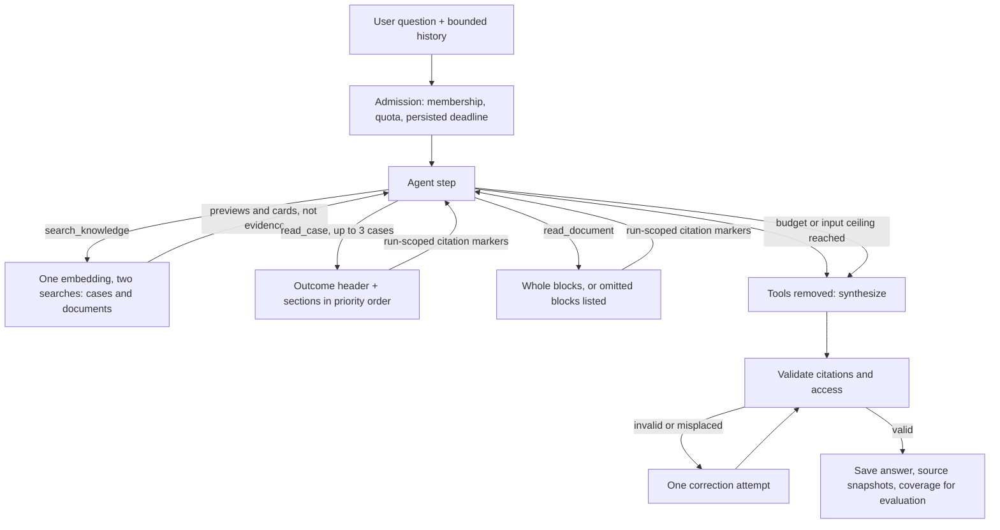

# How the agent engine steers the model

Memoba's answers are useful because the application controls the model's work, not because it calls a model. This document explains the mental model, the controls, and the evidence behind them. Read it to explain the product's mechanism to reviewers. [System contracts](../reference/system-contracts.md) own the exact rules, and [`limits.ts`](../../src/lib/contracts/limits.ts) owns every number.

## The mental model: the model decides, the application controls

One agent chooses what to do next: search, read a case or a document, ask, or answer. That choice is the only thing the model controls. The application owns everything that must stay true regardless of what the model chooses:

| The model decides | The application guarantees |
|---|---|
| Which queries to search | Search covers only active, published cases and process documents in the user's workspace |
| Which cases, documents and sections to read | Every read is pinned to one revision and counted against a budget, with separate pools for cases and documents |
| When it has enough evidence | Investigation stops at the deadline, tool, step, or input ceiling |
| How to word the answer | Every citation resolves to text it actually read, and access is rechecked |
| What it judges relevant | Per-source state (found, none, failed) is recorded from real tool results, not the model's claim |

The model has no SQL, no workspace selector, and no write tool. It cannot widen its own access or budget. Case text, document text, history, and tool output are passed as data, and the instructions tell it to ignore instructions inside them.

## The run, step by step

1. **Admission.** The server derives the user and workspace from the session, checks membership, enforces the concurrent run quota, and writes a deadline to the database. Model calls, embeddings, tools, and correction all share that deadline.
2. **Search.** `search_knowledge` embeds the query once and runs two searches that settle separately. The case search combines keyword and vector ranking over case sections and keeps at most two sections per case, so a few long cases cannot crowd out the rest. The document search ranks documents by their best section and returns at most five cards with title, description, type, area, owner, effective date, an outline of numbered blocks, and the matched headings. Previews and cards help the model choose; they cannot be cited. Each source reports its own state in the tool event, so the activity view can say "3 cases found · no documents matched" from the event and not from model text.
3. **Read.** `read_case` reads up to three cases per call. Each case starts with a header holding its title, template, outcome state, and observed outcome, followed by requested sections in priority order: approach, outcome, problem, context, constraints, lessons. When the evidence budget runs out, the least useful sections drop first, so a case's outcome is never lost while its background survives. `read_document` reads one document. A block is delivered whole or listed as omitted, so a requirement is never cut in half, and the document pool never spends case budget.
4. **Stop.** Before each step, the application checks the deadline, tool count, step count, and the model's actual input tokens from the previous step. Near any limit it removes the tools, so the next step must answer with what it has.
5. **Validate.** Every `[S:…]` marker must match a section disclosed in this run, and the user must still be allowed to read it. Markers under "What the process says" must be documents and markers under "How similar cases went" must be cases. One correction attempt is allowed within the same deadline. A run that cannot produce a valid answer ends as failed, never as a fabricated one.
6. **Save.** The answer text, the cited source snapshots, usage, and the coverage recorded for evaluation are saved together. Refresh reads the saved result and never restarts the model.

## The controls and the failure each one prevents

| Control | Without it |
|---|---|
| Citations only from read sections, checked after generation | The model cites previews or invents sources |
| Access recheck on every cited source | A saved answer leaks text from a case the user can no longer see |
| Immutable revisions, pinned per run | A citation points to text that changed after the answer |
| Shared persisted deadline | Retries and correction get fresh time and runs never end |
| Tool, step, and synthesis reserve | The agent keeps investigating and never answers |
| Input ceiling from provider usage | The transcript grows past what the evidence budget estimates |
| Outcome-first read order | Budget cuts drop the outcome while keeping background text |
| Two sections per case in search | One long case fills every candidate slot |
| Per-source state from tool events | The answer claims it checked everything when it read two cases, or reads a failed document search as "no policy" |
| Separate case and document pools and placement check | Process text crowds out case outcomes, or a case is cited as the rule |
| Search failure distinct from empty | An outage is reported as "no precedent" |
| Generated advice kept apart from outcomes | Proposed steps are later read as things the team did |
| Documents kept apart from cases | A requirement is read as something the team did, or a past case is called a violation |
| Import drafts never saved without a person | AI-written text becomes recorded team experience |

## Steering through instructions

The [agent instructions](../../src/modules/analysis/agent.ts) follow OpenAI's GPT-6 prompting guidance: a static developer message with Identity, Instructions, and Context sections, Markdown structure, and the per-request data wrapped in `<request>` at the end so the static part can be cached. They ask the model to:

- infer intent and ask a clarifying question only when the answer would change the advice;
- search again with different wording and look for failures or counterexamples;
- read every clearly relevant case it saw, up to about eight, and the process documents that apply, before answering;
- answer in a fixed shape: a direct opening sentence, what the process says (with version, effective date, and owner), how similar cases went, where practice and process differ (only for a specific requirement a case contradicted or lacked), what is different this time, suggested next step;
- treat search results as candidates and read only the documents that apply, adding blocks on scope, approvals, exceptions, or escalation when it names blocks;
- treat cases as what happened and documents as what is required now, report both when they differ, and never call a case a violation;
- say when the process is silent on a point, report conflicting documents without choosing, and give a document's stated exception route instead of softening a requirement;
- say plainly, per source, when a successful search found nothing relevant, and never claim absence from a source that failed.

The instructions shape behavior. The controls above enforce what must not depend on the model following them.

## What the evaluations taught

Each change was measured against the same seven questions over the demo corpus. Process documents were measured separately against four scenarios and five seed documents; the results are in [evaluation status](../reference/evaluation.md). [Evaluation status](../reference/evaluation.md) records the run IDs, tokens, and timings.

- **Detailed cases exposed the context design.** Rich retrospectives fit only a few full cases in the original evidence budget, and `read_case` spent budget on sections the model did not ask for. The read order and limits were changed, then measured. No read-side context limit was hit afterwards, and peak model input stayed far below the ceiling.
- **One limit was tuned from evidence.** At the starting preview budget, two broad questions saw only part of the matching cases. Doubling it fixed that. The other starting values were kept because the runs did not justify changing them.
- **Prompt structure fixed format, not honesty.** The restructured instructions raised the coverage line from three of seven answers to seven of seven in the exact format. But the model's "matching" count was its own judgment: it wrote "2 of 2" after search surfaced 12 to 18 cases.
- **So the application took ownership of the count.** Coverage was computed from tool events and rendered by the app. The line has since been removed from the answer view; the run still records coverage from tool events for evaluation, and the activity view words per-source results from the tool event code. The lesson generalizes: put a rule in the prompt when you want behavior, and in code when a reviewer must be able to trust it.
- **Higher reasoning effort was not worth it.** Medium effort read slightly more cases at the same compliance and token use, with about a third more latency, so low remains the default.

These are individual observed runs, not a quality score. Whether the advice fits a real decision still needs human review.

## Deliberate limits and the next step

One run reads a handful of cases well. It does not compare every case in a large corpus. The next architectural step, when questions need that, is batched reading that produces short cited notes per group of cases, followed by a synthesis across groups, or precomputed case cards that let search cover more cases in less context. Both add model calls and cost, so they are deferred for this demo. Document parsing, connectors, per-visitor workspaces, and durable background resume are also deferred, as listed in the [product design](../superpowers/specs/2026-10-29-text-agent-design.md).
