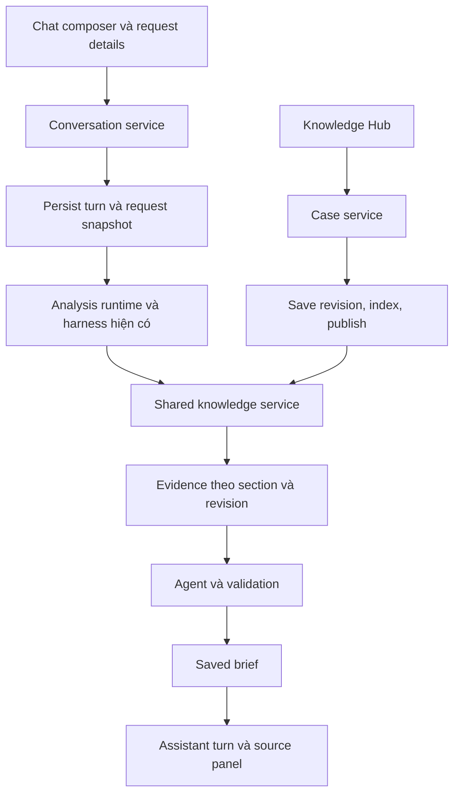

# Chat và Knowledge Hub

**Ngày:** 2026-10-28. **Trạng thái:** Foundation đã triển khai theo scope người dùng cập nhật.

## Scope foundation được chọn khi triển khai

Người dùng yêu cầu dựng luồng kiến trúc trước, deep dive chức năng ở các branch sau. Foundation gồm persistence, quyền truy cập, sidebar, Chat, Knowledge Hub và adapter nối turn vào engine hiện có. Follow-up chỉ mang request context và constraints do người dùng xác nhận; chưa đưa previous proposals vào model hay thêm history budget. Live-model response tests tiếp tục tạm dừng.

Stream được đặt ở shared workspace layout. Client navigation giữ connection thay vì ngắt khi mở Knowledge Hub. Full reload vẫn chỉ đọc trạng thái đã lưu. Các mục phía dưới mô tả plan đầy đủ; mục history/proposal context và live acceptance chưa thuộc foundation đã hoàn tất.

Mục tiêu là để người dùng hỏi và tiếp tục trao đổi trong conversation. Knowledge Hub cung cấp case có cấu trúc cho agent. Engine hiện có tiếp tục sở hữu retrieval, reasoning, validation và provenance.

Người dùng đã xác nhận nhập hoặc dán case qua hai template. Không thêm file import, OCR hay parser.

Plan này thay hướng UI của Task 6 trong [local v0](2026-10-27-local-v0.md). Các việc kiểm chứng còn mở của local v0 vẫn còn hiệu lực. Phạm vi sản phẩm và giới hạn tiếp tục do [design](../specs/2026-10-27-memory-bank-design.md), [foundation](../../architecture/FOUNDATION.md) và [system contracts](../../reference/system-contracts.md) sở hữu. Khi triển khai, cập nhật UX trong design và hợp đồng conversation trong system contracts.

## Checkpoint foundation

Đã có conversation/turn storage, immutable request snapshots, RLS/RPC admission, sidebar responsive, Chat mặc định, Knowledge Hub và redirects cho case/request routes cũ. Chat gọi cùng analysis runtime và stream adapter với endpoint độc lập. Briefs render tại chỗ, citations có prefix theo lượt, và nguồn vẫn qua access checks hiện có.

Đã kiểm chứng lint, typecheck, 48 Vitest tests, 80 native SQL assertions, production build và sáu browser tests với model credentials disabled. Browser tests gồm hai lượt chat có constraints, refresh không tự chạy model, mobile drawer và case lifecycle khi indexing unavailable. Không gọi model hoặc kiểm chứng semantic quality trong đợt foundation.

Còn cho feature branches: previous-proposal context và history budget, live streaming/cancellation với provider thật, live case-to-brief và semantic evaluation. Các checkbox tương ứng phía dưới vẫn mở.

## Hiện trạng trước thay đổi

`WorkspaceLayout` chỉ trả children. `WorkspacePage` ưu tiên Case Library và New request. Luồng hiện tại là request form, trang analysis, rồi trang brief riêng.

`prepareAnalysis` và `runAnalysis` đã có admission, request snapshot, retrieval, evidence registry, agent tools, validation, lưu brief và terminal state. Agent nhận một request độc lập, không nhận lịch sử conversation. Stream phát activity và result, chưa phát câu trả lời theo token.

Case đã có hai template, immutable revisions, indexing, publication, retry, archive và links. Knowledge Hub có thể dùng lại các service này.

Checkpoint trong local v0 ghi nhận live brief chưa hoàn tất và model-response tests đang tạm dừng theo yêu cầu người dùng vì Gemini rate limit. Plan này không chạy lại model tests.

## Trải nghiệm đích

Sidebar desktop gồm New chat, danh sách conversations gần đây, Knowledge Hub và tài khoản/workspace. Mobile dùng drawer. Chat là trang mặc định sau đăng nhập.

| Khu vực | Hành vi |
|---|---|
| Chat mới | Hiển thị composer để đặt câu hỏi và bổ sung context cần thiết |
| Conversation | Lịch sử nhiều lượt, request details theo lượt, activity khi chạy, câu trả lời và citations tại chỗ |
| Knowledge Hub | Danh sách case, tìm/lọc, thêm case, trạng thái sẵn sàng cho agent |
| Case detail | Nội dung, publication hiện hành, bản sửa pending, revisions, concepts, links, retry và archive |

Chat không buộc người dùng đi qua trang request, trang run và trang brief để nhận một câu trả lời. Assistant turn trình bày Reuse Brief đã validate, với sections có thể thu gọn và nguồn mở theo yêu cầu. Chưa thêm một loại output tự do ngoài `DraftBrief`.

Composer giữ structured intake. Câu hỏi đầu vào trường objective; context bắt buộc được nhập ngay trong chat. Template, hard constraints, concepts và unknowns nằm trong vùng Request details có thể mở rộng. Thiếu trường thì mở đúng field và hiển thị lỗi trước khi gọi engine. Không thêm model call để tự suy ra constraints.

Follow-up kế thừa request state đã xác nhận. Nội dung bổ sung được ghi vào context với nguồn là lượt người dùng. Người dùng xem và sửa request details trước khi gửi. Thay objective, template hoặc thêm/xóa/sửa hard constraint là thao tác tường minh; model không tự đổi chúng. Nếu context vượt giới hạn, yêu cầu người dùng rút gọn, không âm thầm cắt yêu cầu.

Conversation mặc định hiển thị cho thành viên workspace, tương ứng quyền đọc run/brief hiện tại. Chỉ tác giả tạo lượt hoặc chạy lại trong conversation của mình. Đây là lựa chọn cho demo một PM; chat riêng tư cần thay đồng bộ quyền đọc run/brief, không chỉ ẩn sidebar.

## Kiến trúc bổ sung

Thêm `src/modules/conversations` để sở hữu conversation, thứ tự lượt, request evolution và liên kết run. Module này gọi analysis service, không chứa bản sao retrieval hoặc agent. `cases`, `knowledge`, `analysis` và `briefs` giữ trách nhiệm hiện tại.

### Lưu trữ và admission

- Thêm `conversations` với workspace, tác giả, title và timestamps. Title lấy từ câu hỏi đầu, không cần gọi model.
- Thêm `conversation_turns` với conversation, thứ tự, parent turn, nội dung người dùng và immutable normalized request snapshot. Dùng `requestSchema` hiện có làm schema nguồn.
- Thêm liên kết nullable từ `analysis_runs` tới turn để giữ các run cũ. Một turn có thể có nhiều attempt; mỗi attempt là một run. Brief tiếp tục thuộc run, không sao chép generated text hoặc evidence vào bảng chat.
- Lưu turn trước khi kiểm tra AI availability/admission. Không có run thì UI hiển thị chưa chạy hoặc không thể bắt đầu, không giả assistant response.
- Admission gắn run vào turn trong transaction. Kiểm tra membership, tác giả, cùng workspace, request khớp snapshot và parent vẫn là lượt mới nhất. Chặn hai lượt chạy đồng thời trong cùng conversation, đồng thời giữ workspace quota hiện có.
- Lặp network request với cùng idempotency key trả cùng turn/run. Retry sau terminal failure dùng attempt key mới trên turn cũ; không sửa run đã kết thúc. Một lượt follow-up mới luôn có snapshot và run mới.
- RLS, RPC và composite foreign keys bảo vệ liên kết workspace/conversation/turn/run. Operation checks tiếp tục chạy dù shell đã xác thực.
- Parse HTTP payload và DB results tại adapter bằng schema nguồn. Các mutation kiểm tra same-origin; authenticated responses dùng private/no-store. RPC kiểm tra payload trực tiếp, không chỉ tin validation của UI.

### Ngữ cảnh giữa các lượt

`NormalizedRequest` tiếp tục là nguồn mục tiêu và constraints. Conversation service tạo snapshot mới từ request state và thay đổi người dùng đã xác nhận, không để client chọn workspace hoặc gửi lịch sử assistant tùy ý.

Để hiểu tham chiếu như "phương án thứ hai", context builder có thể đọc brief gần nhất được phép truy cập. Các phần này được gắn nhãn previous proposal, có run/brief ID, và không đi vào evidence registry. Không đưa edited text vào như output đã validate.

Lượt mới dùng registry mới và retrieval mới theo knowledge version hiện hành. Historical claims phải có evidence được đăng ký và kiểm quyền trong lượt mới. Brief cũ vẫn giữ nguồn/revision của chính nó; case archived chỉ còn xuất hiện qua lịch sử được phép đọc.

Đặt giới hạn history trong `src/lib/contracts/limits.ts` khi triển khai. Request, history và evidence phải được tính trong ngân sách context chung, gồm cả các lần tools bổ sung evidence và repair. Ưu tiên request/constraints và evidence; bỏ previous proposals trước nếu không đủ chỗ. Không gửi toàn bộ transcript không giới hạn và không thêm summarizer model trong bản này.

### Stream và kết quả

Mở conversation route trước khi bắt đầu analysis. Component chat sở hữu stream, thay cho cleanup trong `RequestForm` hiện tại. Không điều hướng khi vừa nhận run ID rồi vô tình abort request.

Stream giữ actual activity từ backend. Chỉ hiển thị assistant answer khi brief hợp lệ và đã persist; không diễn token playback giả. Sources/activity mở theo từng turn, với DOM IDs có turn/run prefix để citations không trùng.

Refresh hoặc mở lại chat đọc persisted turns, attempts, run state và authorized briefs. Không tự chạy lại model. Cancel/disconnect giữ terminal state hoặc chờ reconcile timeout theo contract hiện tại; không hứa durable resume. Chuyển sang Knowledge Hub trong lúc chạy phải hiển thị rõ việc ngắt lượt theo cơ chế request-driven hiện có.

## Routes và API đề xuất

| Route | Trách nhiệm |
|---|---|
| `/workspace` | Redirect tới `/workspace/chat` |
| `/workspace/chat` | New chat |
| `/workspace/chat/[id]` | Conversation đã lưu |
| `/workspace/knowledge` | Case library |
| `/workspace/knowledge/new` | Nhập case theo template |
| `/workspace/knowledge/[id]` và `/edit` | Case detail và edit |
| `/api/conversations` | List và create với verified scope |
| `/api/conversations/[id]` | Đọc conversation và turns |
| `/api/conversations/[id]/turns` | Lưu lượt idempotent, validate request evolution |
| `/api/conversations/[id]/turns/[turnId]/analyses` | Admission/stream attempt dùng analysis service hiện có |

`/api/analyses` vẫn phục vụ request độc lập cũ. Hai endpoint gọi cùng service và cùng admission policy. `/api/cases`, `/api/analyses/:id` và `/api/briefs/:id` giữ chức năng hiện tại.

Redirect `/workspace/requests/new` sang new chat và các `/workspace/cases/*` sang route Knowledge Hub tương ứng. Giữ standalone analysis/brief routes để các run cũ không mất đường mở. Các trang này dùng chung shell và có link tới conversation khi run đã được liên kết. Không tạo conversation giả cho dữ liệu cũ.

## Thứ tự thực hiện và bằng chứng

### 1. Chốt contracts và conversation persistence

**Files:** design UX, `system-contracts.md`, `FOUNDATION.md`, `src/modules/conversations/{schema,service,repository}.ts`, migration mới, generated database types, SQL/unit tests và conversation CRUD routes.

- [ ] Cập nhật product UX và hợp đồng request evolution, history budget, quyền đọc/ghi, retry và admission.
- [x] Tạo bảng/RPC/RLS và liên kết turn/run; giữ tương thích runs cũ.
- [ ] Viết tests cho quyền truy cập, forged IDs, same-workspace links, concurrent parent conflict, idempotent save/admission, snapshot bất biến và retry attempts.
- [ ] Chứng minh turn lưu được khi AI unavailable hoặc quota đầy, không tạo run mồ côi và không làm mất nội dung.

### 2. Tạo app shell và Knowledge Hub

**Files:** `src/app/workspace/layout.tsx`, shared workspace navigation, chat entry, knowledge routes, case UI links, browser tests.

- [x] Thêm sidebar/drawer bằng shadcn CLI; chỉ thêm component thực sự dùng. Đọc docs của phiên bản Next.js/shadcn đã cài trước khi dùng API mới.
- [x] Chuyển default entry sang Chat; tạo Knowledge Hub bằng case library/forms/detail/actions hiện có.
- [x] Hiển thị saved, indexing failed/pending, published ready và archived đúng dữ liệu. Chỉ publication ready của active case mới sẵn sàng cho retrieval.
- [ ] Đổi internal links, redirects và E2E selectors. Kiểm tra desktop/mobile, keyboard focus, active navigation và empty states trong app đang chạy.

### 3. Nối chat tới engine

**Files:** conversation composer/view, conversation-turn analysis route, `analysis/{runtime,repository,harness,agent,tools}.ts` tại các điểm tích hợp cần thiết, `knowledge/context.ts` khi cần chia ngân sách, brief/source presentation và tests.

- [x] Nhập câu hỏi và request details trong chat; lưu turn rồi khởi động attempt.
- [x] Tái dùng admission, harness, real activity, validation và brief persistence. Render brief inline và sources theo turn.
- [ ] Thêm bounded previous-proposal context, bảo toàn constraints và dùng registry mới cho follow-up. Ngân sách hiện có vẫn do file limits sở hữu.
- [ ] Test hai lượt có snapshots/runs riêng, tham chiếu previous proposal, sửa constraint tường minh, history overflow và output cũ không thành observed evidence.
- [ ] Test duplicate submit, quota, AI unavailable, gap report, query failure, invalid output, cancel, timeout, disconnect và refresh bằng test helpers/service thật phù hợp. Không thêm runtime mock.

### 4. Kiểm chứng flow và cập nhật tài liệu

**Files:** `tests/e2e/chat.spec.ts`, các E2E hiện có, `docs/how-to/run-locally.md`, local-v0 checkpoint và README khi flow đổi.

- [x] E2E login → new chat → nhập request → mở lại conversation → follow-up; xác nhận không mất lịch sử hoặc tự chạy lại khi refresh.
- [x] E2E Chat ↔ Knowledge Hub, thêm/sửa case, index unavailable, retry và archive; không thay thế lifecycle checks bằng việc chỉ thấy một card trong UI.
- [x] Chạy lint, typecheck, Vitest, native SQL checks và production build theo scripts trong `package.json`. Chạy default Playwright suite với model credentials disabled.
- [ ] Mở app kiểm tra sidebar/mobile, composer, saved history và unavailable/error states. Offline checks không chứng minh một live answer thành công.
- [ ] Giữ `@live` checks tạm dừng đến khi người dùng cho chạy lại. Khi được chạy, kiểm tra hai lượt có model thật, citations mở đúng revision, case mới ready được retrieval và saved brief tồn tại sau reload.
- [x] Ghi riêng kết quả offline, live-model và semantic evaluation. Không đánh dấu toàn bộ local v0 hoàn tất chỉ từ thay đổi UI.

## Điều kiện hoàn tất

Người dùng vào Chat mặc định, tiếp tục cùng conversation, và nhận kết quả có nguồn ngay trong chat. Knowledge Hub là nơi nhập/dán, cập nhật và quản lý hiệu lực case qua hai template. Engine và evidence rules hiện tại được dùng lại, có kiểm thử cho conversation state mới. Mọi kiểm chứng model còn tạm dừng phải được ghi rõ trước khi gọi release hoàn tất.
